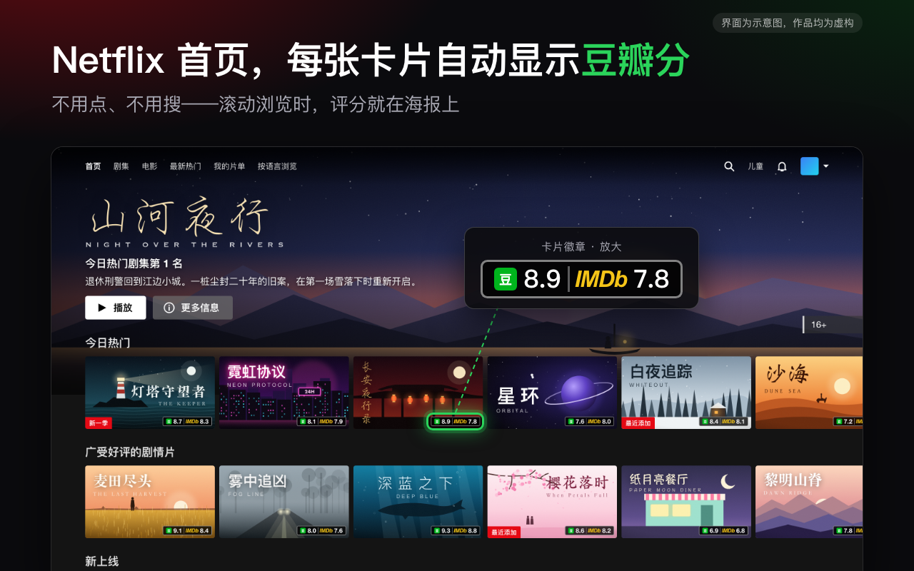

# DouRate

在 Netflix、Prime Video 和 Disney+ 的浏览卡片与详情页上，自动显示豆瓣评分和 IMDb 评分。选片不用再一部部去豆瓣搜。

Douban and IMDb ratings on every Netflix, Prime Video and Disney+ card and title page.

**[从 Chrome 应用商店安装 / Install from the Chrome Web Store](https://chromewebstore.google.com/detail/bdjlmdohbjllclekdldokapgdaacelnn?utm_source=github&utm_medium=readme&utm_campaign=launch)** · 免费 / Free · 无广告 / No ads · 无需注册 / No account

> 最新版只在 Chrome 应用商店发布，并会自动更新；本仓库不再更新源码和安装包。
>
> The latest version is published only on the Chrome Web Store and updates automatically. This repository no longer receives source or package updates.

## 中文

### 能做什么

- **卡片上直接看分：** 在首页和分类页滚动浏览时，每张卡片会自动显示豆瓣分和 IMDb 分，不用点，也不用搜。
- **详情页双评分：** 豆瓣分、IMDb 分和 IMDb 投票数并列显示，点击可直达对应条目。
- **不乱猜：** 结合年份、类型和片长确认后才显示分数；匹配不确定时显示「?」。
- **三大平台：** Netflix、Amazon Prime Video、Disney+。

### 开始使用

1. 从 [Chrome 应用商店](https://chromewebstore.google.com/detail/bdjlmdohbjllclekdldokapgdaacelnn?utm_source=github&utm_medium=readme&utm_campaign=launch) 安装，安装后会自动打开欢迎页。
2. 在当前浏览器登录自己的豆瓣账号（推荐，查询更稳定）。
3. 在欢迎页或 DouRate 弹窗中下载一次 IMDb 官方数据（约 9 MB），之后可选择自动更新。
4. 刷新 Netflix、Prime Video 或 Disney+ 页面。

之前用 ZIP 手动安装过的话，请在 `chrome://extensions` 移除旧版，再从商店安装，之后就会自动更新。重装后需要在弹窗里重新下载一次 IMDb 数据。

### 隐私

DouRate 只在你的浏览器里运行，没有开发者服务器，也不需要账号。豆瓣查询由你的浏览器直接发起；IMDb 评分来自 IMDb 官方数据集，在本机建立索引。详见 [隐私政策](PRIVACY.md)。

### 文档

- [用户文档 / Wiki](https://github.com/shenleee/DouRate/wiki)：工作方式与限制、支持平台、FAQ、故障排查、隐私与数据来源。
- [隐私政策 / PRIVACY.md](PRIVACY.md)

### 项目边界

插件在用户浏览器中运行，不提供开发者后端。豆瓣查询由用户浏览器直接发起；IMDb 首次数据下载需用户主动触发，之后可选择在该浏览器自动更新。请勿批量采集、共享 IMDb 数据或将其用于公开／商业服务。详情见 [Wiki 的隐私与数据来源说明](https://github.com/shenleee/DouRate/wiki/Privacy-and-Data-Sources)。

## English

### What it does

- **Ratings on every card:** as you scroll the home and genre pages, each card shows its Douban and IMDb scores. No clicking, no searching.
- **Both scores on title pages:** Douban score, IMDb score and IMDb vote count side by side, each linking to its source page.
- **No guessing:** a score appears only after year, type and runtime agree; uncertain matches show “?”.
- **Three platforms:** Netflix, Amazon Prime Video, Disney+.

### Get started

1. Install from the [Chrome Web Store](https://chromewebstore.google.com/detail/bdjlmdohbjllclekdldokapgdaacelnn?utm_source=github&utm_medium=readme&utm_campaign=launch). A welcome page opens.
2. Sign in to your own Douban account in this browser (recommended for stable results).
3. Download IMDb’s official dataset once (about 9 MB) from the welcome page or the DouRate popup; automatic updates are optional.
4. Refresh Netflix, Prime Video, or Disney+.

If you installed an earlier ZIP manually, remove it at `chrome://extensions` and install from the store so you get automatic updates. Download the IMDb data again from the popup after reinstalling.

### Privacy

DouRate runs entirely in your browser, with no developer server and no account. Douban lookups are made by your own browser; IMDb ratings come from IMDb’s official dataset, indexed on your device. See the [privacy policy](PRIVACY.md).

### Documentation

- [User documentation / Wiki](https://github.com/shenleee/DouRate/wiki): behaviour and limits, supported platforms, FAQ, troubleshooting, privacy, and data sources.
- [Privacy policy / PRIVACY.md](PRIVACY.md)

### Project boundary

The extension runs in the user’s browser and has no developer backend. Douban requests are made directly by the user’s browser; the first IMDb-data download requires a user action, after which the user can choose automatic updates in that browser. Do not bulk-collect, redistribute IMDb data, or use it in a public/commercial service. See the [Privacy & Data Sources wiki page](https://github.com/shenleee/DouRate/wiki/Privacy-and-Data-Sources).

Information courtesy of IMDb (https://www.imdb.com). Used with permission.
